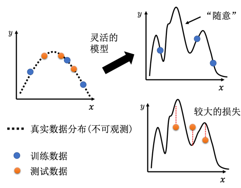

# LeeDL

## Chapter1 机器学习基础

### 1.1 机器学习的框架
1. 模型

>- 神经元是啥？
>
> 一个神经元接收输入，进行加权求和，再通过激活函数产生输出。
>
> $$
> \text{激活函数} \to \text{神经元的一部分} \to \text{神经网络}
> $$
>
> - 什么是隐藏层？
>
> 输入层和输出层之间的层叫隐藏层。

2. 定义损失
  1，2 都需要对任务本身的knowledge
3. 优化
loss 学习率

4. 训练
一个Batch更新一次参数, 一个Epoch遍历一遍样本

### 1.2 线性模型
激活函数
#### Sigmoid

$$
\sigma(x)=\frac{1}{1+e^{-x}}
$$

#### Hard Sigmoid

$$
\mathrm{HardSigmoid}(x)= 
\begin{cases}
0 & x \leq 0 \\
x & 0 < x < 1 \\
1 & x \geq 1
\end{cases}
$$

#### ReLU

$$
\mathrm{ReLU}(x)=
\begin{cases}
x & x>0\\
0 & x\leq0
\end{cases}
$$

Hard Sigmoid 可以由两个 ReLU 组成：

$$
\mathrm{HardSigmoid}(x)=\mathrm{ReLU}(x)-\mathrm{ReLU}(x-1).
$$

> - 神经元数量多于输入向量长度会有问题吗?
>
> 没啥问题，增加过拟合可能性

## Chapter2 改进模型的几个思路

### 2.1 模型偏差

模型灵活度不够，不管怎么优化都找不到loss小的参数。

**解法：**

1. 给更多特征：input更多信息
2. 更多参数，更大灵活度：加层数

### 2.2 优化不好
模型够了，但是优化器能力不够找不到这个参数。

例子：

这个不是过拟合，56层只要前20层和20的一样，后面36层不变就可以，显然是没有优化出来。

**解法：**
先搞一个小模型：层数更浅，参数更少，如线性模型和SVM。虽然它的函数空间不是完全被我们的模型包含，但是可以作为参考。如果这个模型的loss要更低，说明优化器有问题；如果这个模型也不好，说明模型本身的偏差太大。

### 2.3 过拟合

训练集上表现远远好于测试集

为什么会过拟合：

**解法：**
1. 数据增强，增加训练样本：将图片左右翻转或者截其中一块
2. 限制模型灵活度：不过需要有一些knowledge
(1) 给模型减少参数：CNN的函数空间包含在全连接网络内，CNN在图像处理是表现更好
(2) 减少特征数量
(3) 早停：训练到验证集表现最好时就停下，避免继续复杂化参数。
(4) 正则化：在训练目标中惩罚过大的参数，促使模型采用较平稳的规律。
(5) Dropout：训练时随机屏蔽一部分神经元，减少模型对某几个神经元或特征组合的依赖。
> - more about dropout
>
>比如模型判断一张图是不是猫，原本可能只靠一个神经元记住“训练集里有猫的图片背景都偏蓝”。它在训练集上答得很好，但换个背景就错了。
>
>用了 Dropout 后，这个神经元有时会被关掉。模型这次还得答题，就必须学会利用耳朵、胡须等其他线索。反复训练后，它较难只依赖某一条碰巧有效的线索，因此在新图片上通常更稳。
>
>随机关闭只发生在训练时；实际预测时会使用完整模型。Dropout 也不是一定有效，如果关闭太多，模型可能连有用的规律都学不好。

### 2.4 交叉验证

#### 验证集

公开测试集：leaderboard，私人测试集：真正比赛用的。对应的是我现在的test 集，和以后真实使用场景中的未知扰动。

为了选择模型的方法对这两个测试集一致，不应该直接用公开测试集选模型。这样公开测试集的分数可以较好地反映在私人测试集上的分数。

#### 怎么解决验证集选的不好导致选模型不好？
K 折交叉验证：把数据按预先确定的划分单位，分成 \(K\) 个互不重叠、大小尽量接近的部分。进行 \(K\) 次实验：每次轮流留出一部分评估模型，用其余部分训练。这样，每个数据单位恰好被留出评估一次；最后汇总各次的评估结果。

### 2.5 不匹配

测试集和训练集分布不同。根本预测不出来。

**解法：**
要对训练集跟测试集的产生方式有一些理解，才可以判断到底是不是不匹配。

## Chapter3 优化
为什么优化器找不到loss最小的参数？

### 3.1 临界点

局部极小值or鞍点？临界点的梯度为0，会让优化器无法继续优化。

### 3.2 Batch
 常用trick：每个epoch，batch重新划分

