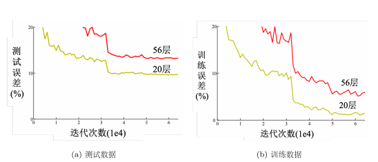

# LeeDL

## Chapter1 机器学习基础

### 1.1 机器学习的框架
1. 模型

>- 神经元是啥？
>
> 一个神经元接收输入，进行加权求和，再通过激活函数产生输出。
>
> $$
> \text{激活函数} \to \text{神经元的一部分} \to \text{神经网络}
> $$
>
> - 什么是隐藏层？
>
> 输入层和输出层之间的层叫隐藏层。

2. 定义损失
  1，2 都需要对任务本身的knowledge
3. 优化
loss 学习率

4. 训练
一个Batch更新一次参数, 一个Epoch遍历一遍样本

### 1.2 线性模型
激活函数
#### Sigmoid

$$
\sigma(x)=\frac{1}{1+e^{-x}}
$$

#### Hard Sigmoid

$$
H(x)=
\begin{cases}
0, & x\leq 0,\\
x, & 0<x<1,\\
1, & x\geq 1.
\end{cases}
$$

#### ReLU

$$
\operatorname{ReLU}(x)=\max(0,x)=
\begin{cases}
0, & x\leq 0,\\
x, & x>0.
\end{cases}
$$

Hard Sigmoid 可以由两个 ReLU 组成：

$$
H(x)=\operatorname{ReLU}(x)-\operatorname{ReLU}(x-1).
$$

> - 神经元数量多于输入向量长度会有问题吗?
>
> 没啥问题，增加过拟合可能性
> 
>- 过拟合
>
> 加多训练轮次，训练集表现更好，测试集表现更差

## Chapter2 为啥模型效果不好

### 2.1 模型偏差

模型灵活度不够，不管怎么优化都找不到loss小的参数。

**解法：**

1. 给更多特征：input更多信息
2. 更多参数，更大灵活度：加层数

### 2.2 优化不好
模型够了，但是优化器能力不够找不到这个参数。

例子：

这个不是过拟合，56层只要前20层和20的一样，后面36层不变就可以，显然是没有优化出来。

**解法：**
先搞一个小模型：层数更浅，参数更少，如线性模型和SVM。虽然它的函数空间不是完全被我们的模型包含，但是可以作为参考。如果这个模型的loss要更低，说明优化器有问题；如果这个模型也不好，说明模型本身的偏差太大。
